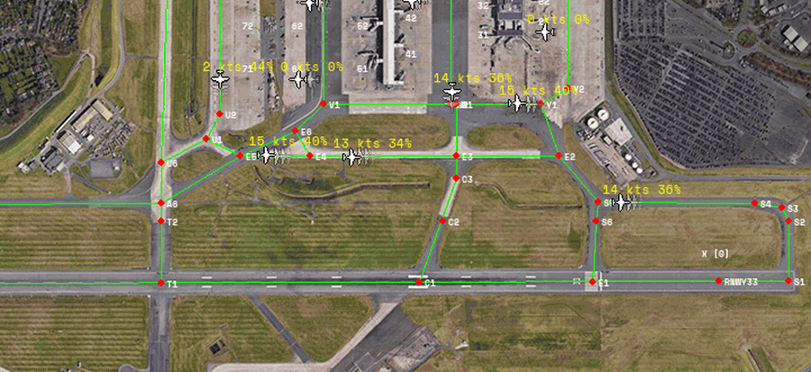

# Autonomous ATC

An AI ground controller for Birmingham Airport, in a 2D simulation. Aircraft push back, taxi, queue,
take off and land on their own. Four deep learning models do the job a human controller would.

This is the proof of concept from my MEng thesis, *A Proof of Concept for Autonomous Air Traffic
Control Using Deep Learning* (University of Birmingham, 2024–25, supervised by Dr Jian Liu).



*Departures taxi out from their stands and queue behind each other while the runway is in use.*

## How it works

I split ground control into four jobs, and each one has its own model:

| Job | Model | What it does |
| --- | --- | --- |
| **Taxiing** | Deep Q-learning (multi-headed DQN) | Steers each aircraft along the taxiways at 15–20 knots, within about 7 metres of the centreline. |
| **Collision avoidance** | LSTM | Predicts where every aircraft will be a few seconds ahead. If two predictions overlap, the aircraft further from its goal gives way. Aircraft stay at least about 45 metres apart. |
| **Runway safety** | YOLOv8 | Watches the radar picture of the runway. An aircraft only gets onto the runway when it's empty, so there are no runway incursions. |
| **Pilot requests** | BERT and DistilBERT | Reads a pilot's request as text. It works out the request (pushback, taxi, take-off or landing) and which flight sent it. |

The first three run live in the simulation. I tested the pilot request models separately, on real
speech turned into text.

## Run the simulation

You need **Python 3.9**. From this folder:

```bash
python3.9 -m venv .venv
source .venv/bin/activate        # on Windows: .venv\Scripts\activate
pip install -r requirements.txt

cd simulation
python main.py
```

The first start can take a couple of minutes while the models load. After that it runs by itself.
Departures push back and taxi to the runway, and arrivals land and taxi to a stand. Click **Show
Buttons** at the top left to turn overlays on and off, such as each aircraft's predicted path.

There's more in [simulation/README.md](simulation/README.md).

## What's in here

```
simulation/                The airport simulation, with the trained models built in
training/
├── 1-taxiing/             How the taxiing model was trained (thesis chapter 4)
├── 2-collision-avoidance/ The LSTM, and the two approaches I tried before it (chapter 5)
├── 3-runway-detection/    How the YOLO runway model was trained (chapter 6)
└── 4-pilot-requests/      How the pilot request models were trained and tested (chapter 7)
```

## Limits

It's a proof of concept, not something for a real airport. The models only know this one simulated
version of Birmingham Airport, with simplified physics. They won't adapt to other airports, or to
situations they never saw in training. The thesis covers what real use would need, including safety,
regulation and trust.

## Licence

MIT. See [LICENSE](LICENSE).
