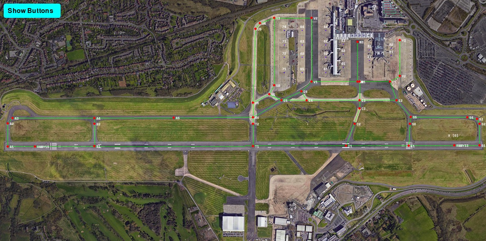
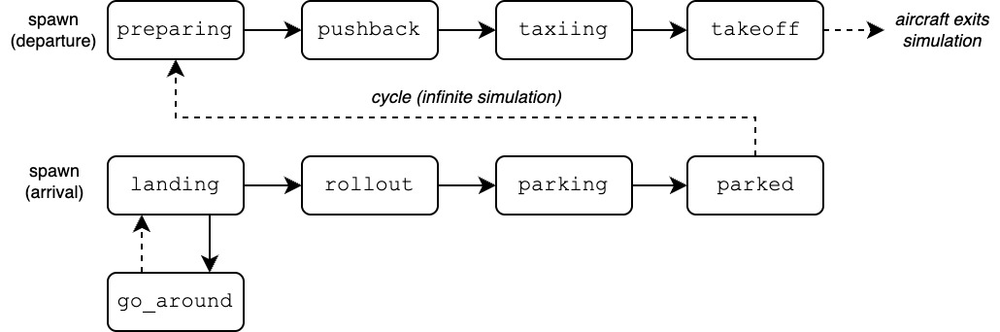

# Simulation

A 2D, top-down simulation of Birmingham Airport (EGBB) with the trained models built in. It handles
the ground side of air traffic control: taxiing, getting aircraft to the runway, landing clearances
and keeping the runway safe. How each model was trained is in [`training/`](../training).

## Setup

You need Python 3.9 on Linux, macOS or Windows, and 8 GB of RAM is recommended. The packages are in
[`requirements.txt`](../requirements.txt). From the top of the repository:

```bash
python3.9 -m venv .venv
source .venv/bin/activate  # on Windows: .venv\Scripts\activate
pip install -r requirements.txt
```

## Running it

From this folder:
```bash
python main.py
```

The first run can take up to 2 minutes to load everything. Later runs start faster. It doesn't need
internet access or any extra downloads.



*The airport with its taxiway network. The red dots are intersections and holding points, and the
green lines are the taxiways between them.*

## What happens

- 10 aircraft start at stands, ready to depart.
- Arrivals keep appearing at safe intervals until the airport is full.
- The taxiing model (DQN) steers every aircraft along its route.
- The LSTM predicts where aircraft are going, and decides who gives way at intersections and in queues.
- The YOLO model watches the runway, so only one aircraft uses it at a time.

Each aircraft goes through these states. A departure leaves after take-off and comes back as an
arrival, so the simulation never ends.



## Overlays

Click **Show Buttons** at the top left for these toggles. All the overlays start on.

| Button | Shows |
| --- | --- |
| Show Future | Each aircraft's predicted positions, from the LSTM |
| Show Nodes | The taxiway intersections and holding points |
| Show Edges | The taxiways connecting them |
| Show Stands | The aircraft stands |
| Show Data | Each aircraft's speed and thrust |
| Show Boxes | The YOLO detection boxes on the runway |
| Normal Speed | The simulation normally runs as fast as it can. This slows it to real time (30 frames a second). |

## Files

- `main.py` – Starts the simulation and runs each frame, including pushback clearance, conflict checks and runway access.
- `plane.py` – An aircraft: its movement, route and state.
- `airport.py` – Loads the airport's taxiway network and draws it.
- `utils.py` – Shared helpers, including route planning with Dijkstra's algorithm.
- `gui.py` – The overlay toggles.
- `configuration.py` – Settings such as the runway in use, landing distances and which overlays are on.
- `model_taxi_DQN.py`, `model_future_LSTM.py` – The model definitions that the trained weights load into.
- `models/` – The trained models: taxiing (DQN), collision avoidance (LSTM) and runway detection (YOLO).
- `data/airport_EGBB.json` – The airport's stands, taxiways, runway, intersections and holding points.
- `assets/` – The airport background, aircraft images and fonts.
