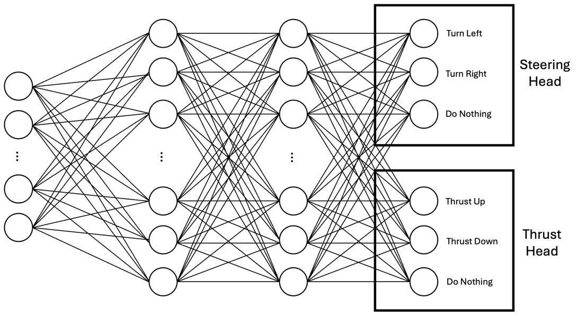
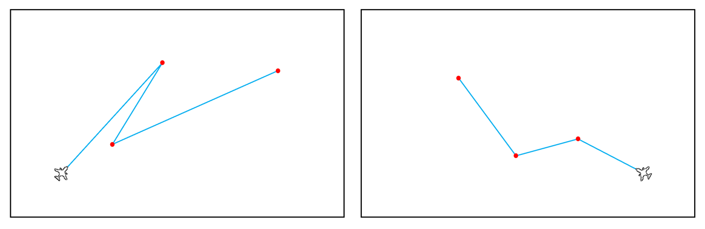
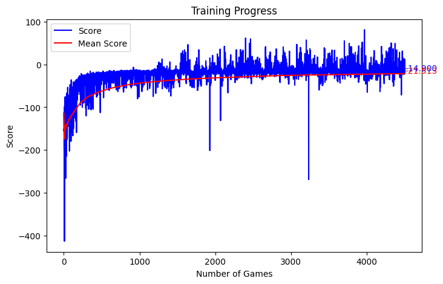

# Taxiing

Training for the model that steers each aircraft along the taxiways, from Chapter 4 of the thesis.

## How it works

The model is a multi-headed deep Q-network (MHDQN). It's one small network with two outputs. One
head steers (left, right or straight), and the other sets thrust (up, down or hold).



It gets seven inputs:

- The distance to the taxiway edge to the left, front and right, measured by ray tracing
- The angle and distance to the next waypoint
- Its speed and thrust setting

Every episode uses a new random route. The agent gets rewards for turning towards the next waypoint,
for reaching each waypoint, and for staying at 15–20 knots. If it stops or strays too far from the
route, the episode ends with a penalty.



*Random training routes. On the left, any angle between legs is allowed. On the right, turns are
limited to 90°, like real taxiways.*

## Result

Developing the approach took over 200,000 training episodes. The final model then trained for 4,000
episodes, which took about four hours. It learned to:

- Stay within 3 pixels (about 7 metres) of the taxiway centreline
- Taxi at an average of 16 knots, inside the 15–20 knot target
- Reach its waypoints without swerving or oscillating



*The final model's training curve. The score rises fast, then levels off.*

## Running it

From this folder:
```bash
python agent.py
```
Every time the model gets a new best score, it's saved to `model/model.pth`. Progress shows as a
graph, or in the terminal if you turn rendering on in `configuration.py`.

## Files

- `taxi_model.py` – The final MHDQN architecture.
- `agent.py` – The training loop.
- `game.py` – The training environment: one aircraft on a random route, and the rewards.
- `model/final_used_model.pth` – The trained model that the simulation uses.
- `model/first_MHDQN_attempt.pth` – The first MHDQN, before the final changes.
- [`early-experiments/`](early-experiments) – The attempts before this one, with their training graphs.

> [!NOTE]
> This is the code as it was during development. I didn't update it after training, so it's
> structured differently from the final simulation.
