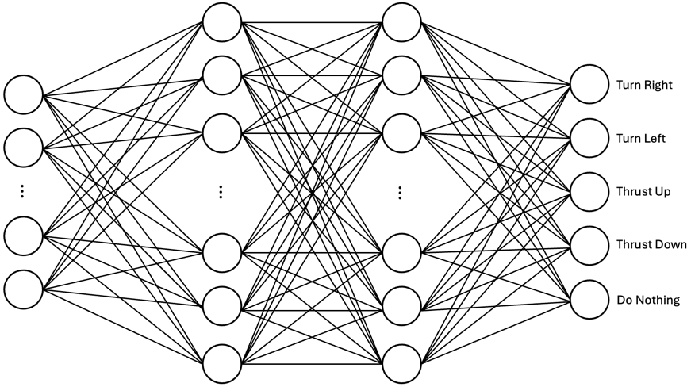
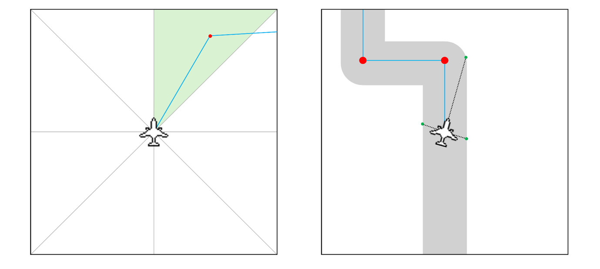
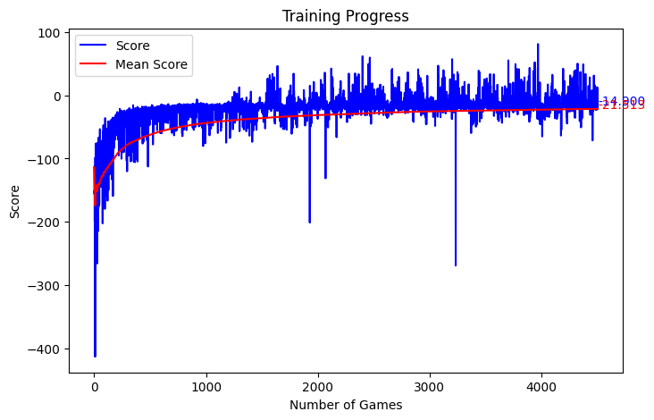
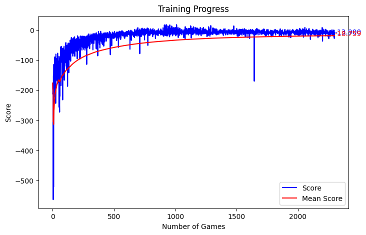
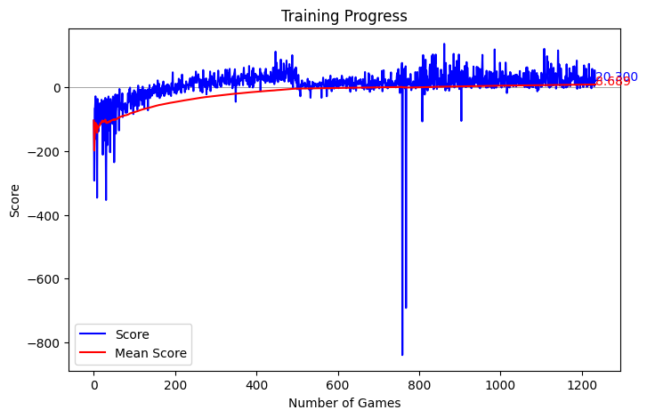

# Early taxiing experiments

How I got to the final model in [`../`](..), from Chapters 4.5.2–4.5.4 of the thesis. None of this
is used by the simulation.

The first models were a standard deep Q-network with one output per action: turn left, turn right,
thrust up, thrust down or do nothing. They learned to game the rewards instead of taxiing. First they
raced straight at the first waypoint and left the area. Later, once they could see the taxiway
edges, they turned on the spot without moving.

*The first network. Steering and thrust shared one output, so the network couldn't tell which
decision a reward was for. Splitting it into two heads fixed that.*

The inputs changed too. At first the aircraft only knew which of eight directions the next waypoint
was in. Then it got beams that measure the distance to the taxiway edges.

*Left: the waypoint's direction, as one of eight sectors. Right: beams to the taxiway edges.*

After the switch to two heads, I tuned the rewards in three steps:

| 1. Steering too weak | 2. Stronger steering rewards | 3. Dynamic rewards |
| --- | --- | --- |
|  |  |  |

## Files

- `GroundTesting.ipynb`, `working_steering.ipynb` – Self-contained training setups from this stage.
  Each one writes out its own environment and model files, then trains.
- `driving.pth`, `steering_too_fast.pth`, `steering_and_speed.pth` – Models saved along the way.
- `1-steering-weak.png`, `2-stronger-steering-rewards.png`, `3-dynamic-rewards.png` – The three
  training graphs above.
