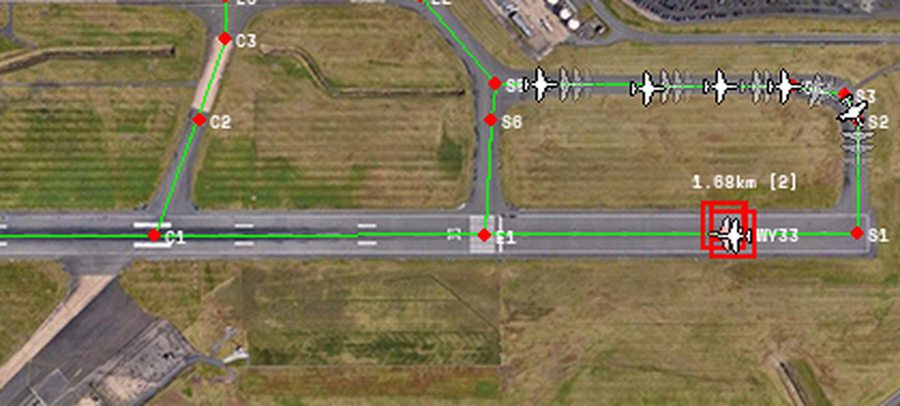

# Collision avoidance

Taxiing aircraft need to queue behind each other and give way at intersections. In Chapter 5 of the
thesis I tried three ways of doing this, and only the last one was good enough to use.

| Folder | Approach | Outcome |
| --- | --- | --- |
| [`multi-agent-rl`](multi-agent-rl) | Multi-agent reinforcement learning, with centralised training and decentralised execution | Tried first. Weeks of reward shaping and experience replay changes didn't give a reliable model. |
| [`classifiers`](classifiers) | Decision trees, logistic regression and random forests deciding stop or go | Good for understanding the problem, but too cautious: aircraft never moved after pushback. |
| [`lstm-prediction`](lstm-prediction) | **An LSTM that predicts where every aircraft will be** | **Used in the simulation.** |

## How the LSTM approach works

The LSTM looks at each aircraft's recent movement and predicts where it will be over the next few
seconds. If two aircraft's predictions overlap, the one further from its final waypoint brakes and
gives way. The other one carries on.

A give-way triggers when predictions get within 36 pixels. Each aircraft is about 17 pixels wide.
That leaves at least 20 pixels (about 50 metres) to slow down, and queueing aircraft stay at least
17 pixels (about 45 metres) apart. Real-world guidance puts the minimum safe gap at about 50 metres.

*Departures queueing for the runway. The faint aircraft ahead of each one are the LSTM's
predictions. The red box is the runway detector seeing the aircraft taking off.*

In the simulation this got rid of every collision, and the queueing looks realistic. The catch is
that it only trained on Birmingham Airport. Another airport's layout would need retraining.
