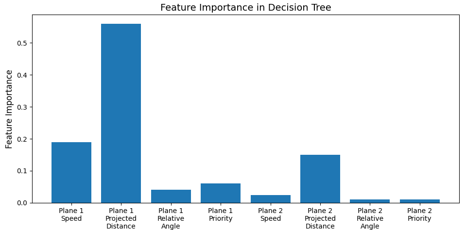
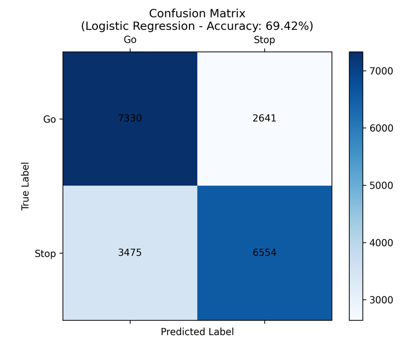

# Classifiers

The second approach to collision avoidance, from Chapter 5.5 of the thesis. Instead of reinforcement
learning, decision trees, logistic regression and random forests learn to say stop or go.

In the simulation they were even more cautious than the multi-agent RL models. Aircraft stopped
after pushback and never moved again. The classifiers only see one moment, with no sense of how a
situation is developing. They helped me understand the problem, but the simulation uses the LSTM in
[`../lstm-prediction`](../lstm-prediction).



*What the decision tree relied on. The features describe the two nearest aircraft. Projected
distance combines how close an aircraft is with how directly ahead it is. The nearest aircraft's
projected distance mattered most, then its speed.*



*The logistic regression model was right 69% of the time.*

## Running it

From this folder:
```bash
jupyter notebook CollisionAvoidanceClassifier.ipynb
```
The notebook does the preprocessing, works out features such as relative angle and projected
distance, then trains and evaluates the models. It scales new data with the same Min–Max and
standardisation parameters it used in training.

## Files

- `CollisionAvoidanceClassifier.ipynb` – The main notebook.
- `training_data.npy` – The training data the notebook uses.
- `raw_training_data_1.npy`, `raw_training_data_2.npy` – The raw data, recorded in the simulation.
- `standardised_data/`, `minmax_data/` – The data after each scaling method, and the fitted scalers.
- `decision_tree_model.pkl`, `linear_regression_model.pkl`, `random_forest_model.pkl` – The trained
  models. Despite its name, the second one is the logistic regression model.
- `before_distance_change.ipynb` – An earlier version of the notebook, from before I changed the
  distance features. It uses the data in `data/`.

> [!WARNING]
> `before_distance_change.ipynb` is only for reference. Its first cell is meant to merge the raw data
> and save it to `data/training_data.npy`. A bug leaves the merged list empty, so running it
> **empties that file**.
