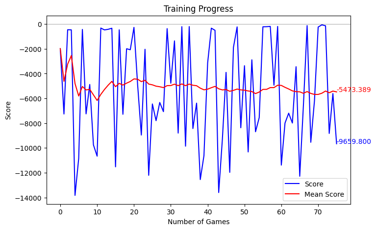
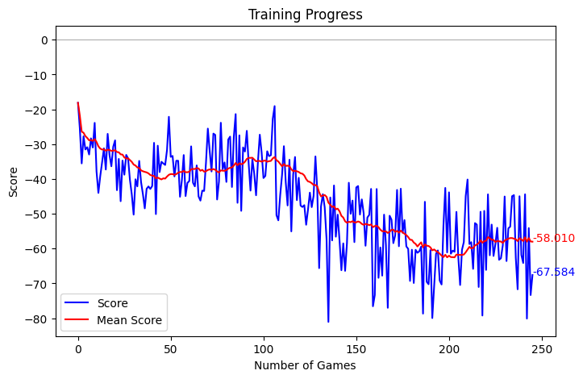
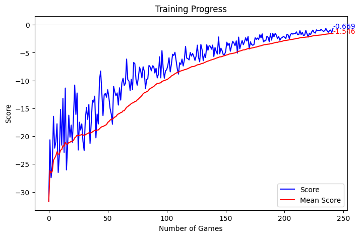

# Multi-agent reinforcement learning

The first approach to collision avoidance, from Chapter 5 of the thesis. Each aircraft was an agent
that had to learn when to stop and give way, sharing experience with the others. It never gave a
reliable model, so the simulation uses the LSTM in [`../lstm-prediction`](../lstm-prediction).

## How it went

The first version's training was unstable and noisy:



Balanced Experience Replay keeps four separate stores of experience: stopping or going, each when it
was right or wrong. It learns from all four equally. The score kept getting worse, and the aircraft
got so cautious they wouldn't move even when they had priority.



Prioritised Experience Replay learns most from the experiences it predicted worst. With tuned
rewards and settings, it gave the best curve, rising well above zero. With longer training, the score
would peak and then collapse, and after that the aircraft hardly ever stopped. None of these models
were stable enough to use.



## Running it

From this folder:
```bash
jupyter notebook CollisionAvoidanceTraining.ipynb
```
The notebook is the latest version, with the final rewards, inputs, and both kinds of experience
replay. Each cell writes out one of the training files (`configuration.py`, `plane.py`, `agent.py`
and so on), and the last cells start training.

> [!NOTE]
> I trained this on Google Colab with a GPU. The notebook now loads the airport layout and models
> from this folder instead of Google Drive.

> [!WARNING]
> Running the notebook overwrites the `.py` files here with the notebook's versions. The `.py` files
> are older than the notebook. `main.py` doesn't run on its own anymore: it crashes when it first
> draws an aircraft. Use the notebook.

## Files

- `CollisionAvoidanceTraining.ipynb` – The training notebook.
- `.py` files – An older version of the training code.
- `raw_training_data_1.npy`, `raw_training_data_2.npy` – Data recorded for the supervised models in
  Chapter 5.5. [`../classifiers`](../classifiers) uses the same files.
