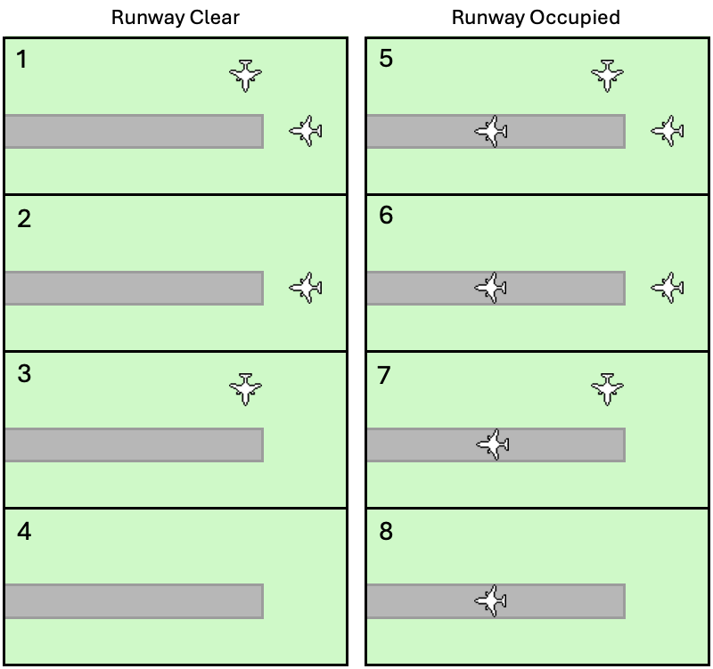
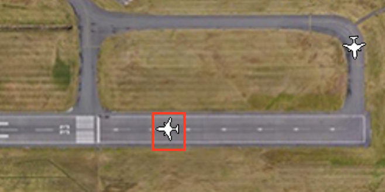
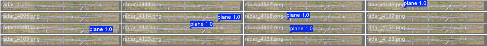

# Runway detection

Training for the YOLOv8 model that spots aircraft on the runway, from Chapter 6 of the thesis. The
simulation uses it to make sure only one aircraft is on the runway at a time.

## How it works

The simulation crops its radar picture to a strip over the runway and the taxiways up to its holding
points. Only one aircraft may be in that strip at a time. YOLO looks at the strip and reports whether
an aircraft is in it, and where. A waiting aircraft only goes onto the runway when the strip is
empty. Departures and arrivals take turns, based on how long each one has waited.



*The eight runway access cases. Left: the runway is clear, so whichever aircraft has waited longer
goes first. Right: it's occupied, so other aircraft hold on the ground or go around.*



## Result

The model trained for 50 epochs on 5,000 generated radar images, half with an aircraft and half
without. That took about an hour. On the validation set:

| Precision | Recall | mAP@0.5 | mAP@0.5:0.95 |
| --- | --- | --- | --- |
| 1.00 | 1.00 | 0.995 | 0.995 |



*Predictions on part of the validation set. Each strip is a crop of the runway. The aircraft are
under the blue labels, and strips without a label are empty.*

It even finds aircraft that are only partly in the strip, like a wingtip. The scores are this high
partly because the task is easy. Aircraft stand out against the background, and the validation
images were made the same way as the training images. In the simulation it runs every half a second
and takes under 100 ms each time.

## Running it

To make the dataset and retrain, run these in order from this folder:

```bash
python generate_dataset.py   # 1. Draw 5,000 radar images into radar_images/, listing each aircraft in labels.csv
python csv_to_txt.py         # 2. Turn labels.csv into one YOLO label file per image, in labels/
python split_dataset.py      # 3. Split the images and labels 80/20 into dataset/, for training and validation
python create_yaml.py        # 4. Write the YOLO config, dataset/data.yaml
yolo task=detect mode=train model=yolov8n.pt data=dataset/data.yaml epochs=50 imgsz=640
```

The last command downloads YOLO's pretrained `yolov8n.pt` to start from, then trains. To try the
trained model on one image, run `python test_model.py`.

> [!NOTE]
> The dataset is about 2 GB, so it's not in the repository. `generate_dataset.py` adds to
> `labels.csv` if it already exists, so delete that file before making a fresh dataset.

## Files

- `generate_dataset.py` – Draws the radar images, with aircraft at random places inside a set area.
- `csv_to_txt.py`, `split_dataset.py`, `create_yaml.py` – Put the images into the layout YOLO expects.
- `best.pt` – The trained model that the simulation uses.
- `test_model.py` – Runs the trained model on a radar image and prints what it found.
- `runs/` – Validation results saved by YOLO, such as metrics and example predictions. `val3` is the
  final model.
- `airport_EGBB.jpg`, `plane_ground.png` – The images the radar pictures are drawn from.
