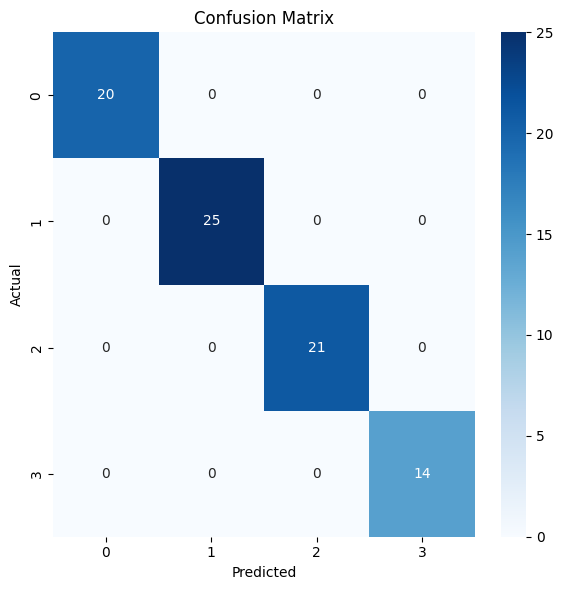
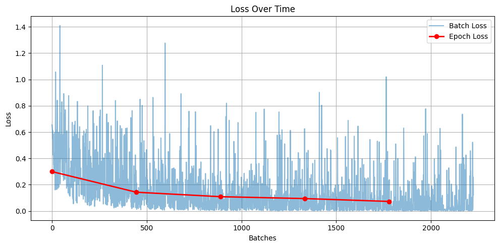

# Pilot requests

Training and testing for the language models that understand pilot requests, from Chapter 7 of the
thesis. There are two tasks:

1. **Request type:** what the pilot wants (pushback, taxi, take-off or landing).
2. **Which flight:** which aircraft sent the request, out of a list of candidates.

## How it works

The dataset started as 400 pilot requests, written to cover lots of ways of saying each one. Speech
to text makes mistakes, so I copied every request and made the copy noisy. Words became homophones
or rhymes, terms like "takeoff" got split in two, and numbers were written as words. That gave 800
requests, half clean and half noisy. Each one has five candidate flights: the right one and four
others, with at least one from the same airline.

- **Request type:** BERT, fine-tuned to sort a request into one of the four types.
- **Which flight:** DistilBERT, trained to rank the candidate flights by how well each one matches
  the request. I tried fuzzy text matching first, as a baseline.

## Result

On the test set:

| Task | Model | Result |
| --- | --- | --- |
| Request type | BERT | 100% accuracy |
| Which flight | Fuzzy matching (baseline) | 31% top-1, 74% top-3 |
| Which flight | DistilBERT | 96% top-1, 100% top-3 |



*Request types on the test set (0 pushback, 1 taxi, 2 take-off, 3 landing). Every one is correct.*



*The flight ranking model's training loss, per batch and per epoch.*

In the practical test, with real speech turned into text, the system was 92% accurate. Every time it
got one wrong, the right answer was its second choice.

## Running the practical test

1. **Download the trained models.** They're too big for the repository (about 670 MB together), so
   they're on the [Releases](https://github.com/nourbashoush/autonomous-atc/releases) page.
   Download `bert_request_classifier.zip` and `bert_flight_ranking.zip`, and unzip both here:

    ```
    4-pilot-requests/
    ├── bert_request_classifier/
    └── bert_flight_ranking/
    ```

    You only need them for `request_analysis.py`. The notebooks train new ones.

2. **Install the packages** from [`requirements.txt`](../../requirements.txt), at the top of the
   repository:

    ```bash
    pip install -r requirements.txt
    ```

3. **Run it:**

    ```bash
    python request_analysis.py
    ```

    This is the experiment from Section 7.6 of the thesis. It shows five random pilot requests, one
    at a time. Read each one aloud, then type in what your speech-to-text heard. It tells you which
    flight and request type it understood.

> [!NOTE]
> You need speech-to-text software for this, such as the dictation built into macOS.

## Files

- `process_dataset.ipynb` – Builds the dataset and makes the noisy copies.
- `train_classification.ipynb` – Fine-tunes BERT for the request type.
- `fuzzy_extraction.ipynb` – The fuzzy matching baseline, using Levenshtein distance.
- `train_extraction.ipynb` – Trains the DistilBERT flight ranking model.
- `request_analysis.py` – The practical test from Section 7.6.
- `data/` – The dataset, with the requests and their labels.
- `utils/` – Helper scripts, such as homophone and rhyme generation.
